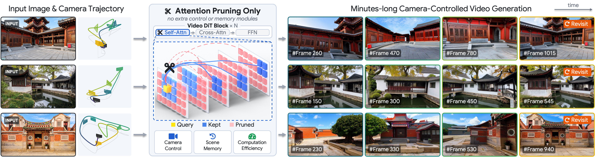
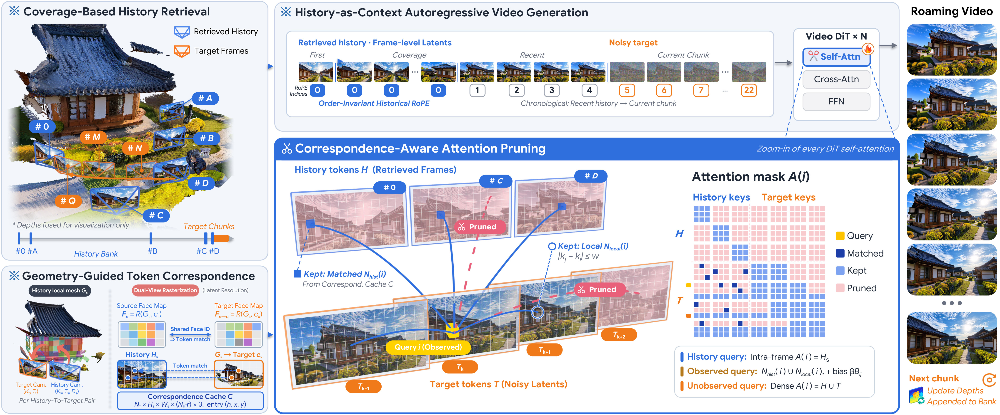

<div align="center">


# SPARC: Geometry-Guided Attention Pruning for Long-Horizon Camera-Controlled Video Generation

### ARXIV 2026

<p>
  <a href="https://yzszy.github.io/">Zesong Yang</a><sup>1</sup>,
  <a href="https://chenweikai.github.io/">Weikai Chen</a><sup>2‡</sup>,
  <a href="https://scholar.google.com/citations?user=WhwTrhcAAAAJ&hl=zh-CN">Liyuan Cui</a><sup>1</sup>,
  <a href="https://y-u-a-n-l-i.github.io/">Yuan Li</a><sup>1</sup>,
  <a href="https://jaceyhuang.github.io/">Jiaxin Huang</a><sup>1</sup>,
  <a href="https://lutao2021.github.io/">Lutao Jiang</a><sup>3</sup>,
  Runze Zhang<sup>2</sup>,
  <br>
  Yingda Yin<sup>2</sup>,
  Xiaoyang Huang<sup>2</sup>,
  Kai Yan<sup>2</sup>,
  Keyang Luo<sup>2</sup>,
  Xin WANG<sup>2</sup>,
  <a href="http://www.cad.zju.edu.cn/home/bao">Hujun Bao</a><sup>1</sup>,
  <a href="https://zhpcui.github.io/">Zhaopeng Cui</a><sup>1†</sup>
</p>

<p>
  <sup>1</sup>State Key Laboratory of CAD&amp;CG, Zhejiang University &nbsp;&nbsp;
  <sup>2</sup>LIGHTSPEED &nbsp;&nbsp;
  <sup>3</sup>HKUST(GZ)
</p>

<p>
  <sup>‡</sup>Project Lead &nbsp;&nbsp; <sup>†</sup>Corresponding Author
</p>

[](https://zju3dv.github.io/SPARC/)
[](https://arxiv.org/abs/2611.34064)
[](https://zju3dv.github.io/SPARC/#video)
[](LICENSE)

</div>

## 📰 News

- **[Coming Soon]** Code will be released before 2026-12-10. Stay tuned! 🚀
- **[2026-11-25]** Release project page and arxiv paper. 🌏

## ✨ Overview

<p align="center">
  
</p>

We present SPARC, a geometry-guided attention pruning framework that turns the native self-attention of pretrained video diffusion transformers into a unified mechanism for camera control and persistent scene memory. Our key insight is that **attention connectivity** can simultaneously serve as geometric conditioning for camera control and spatial addressing for historical memory retrieval. Motivated by the asymmetric contextual requirements of reconstructing observed content and synthesizing novel regions, SPARC restricts observed tokens to geometrically corresponding historical tokens and local spatiotemporal context, while preserving dense attention for unobserved regions. Correspondence-aware attention biasing and order-invariant historical positioning further enable stable retrieval across long temporal gaps. Without introducing additional learnable control or memory modules, SPARC achieves precise camera adherence and faithful scene revisitation while substantially reducing attention computation. Extensive experiments demonstrate the effectiveness of aggressive attention pruning in improving camera adherence, revisit consistency, and visual fidelity, with an inference speedup of over 50x when combined with four-step distillation.

## 🔬 Method overview

<p align="center">
  
</p>

**System overview.** For each target chunk, SPARC establishes token-level correspondences with historical observations through local geometric projection, and prunes the backbone's native self-attention to focus on geometrically corresponding historical tokens and local spatiotemporal context for previously observed regions, while newly revealed regions retain dense attention. Historical RoPE re-indexing removes artificial temporal ordering among the retrieved observations; generated observations are appended to the history bank for continuous rollout.

## 📄 License

Original SPARC code is licensed under [Apache 2.0](LICENSE).
Third-party components retain their respective licenses.

## 📝 Citation

If you find this work useful for your research, please consider citing:

```bibtex
@article{yang2026sparc,
  title   = {SPARC: Geometry-Guided Attention Pruning for Long-Horizon Camera-Controlled Video Generation},
  author  = {Yang, Zesong and Chen, Weikai and Cui, Liyuan and Li, Yuan and Huang, Jiaxin and
             Jiang, Lutao and Zhang, Runze and Yin, Yingda and Huang, Xiaoyang and Yan, Kai and
             Luo, Keyang and Wang, Xin and Bao, Hujun and Cui, Zhaopeng},
  journal = {arXiv preprint arXiv:2611.34064},
  year    = {2026}
}
```
